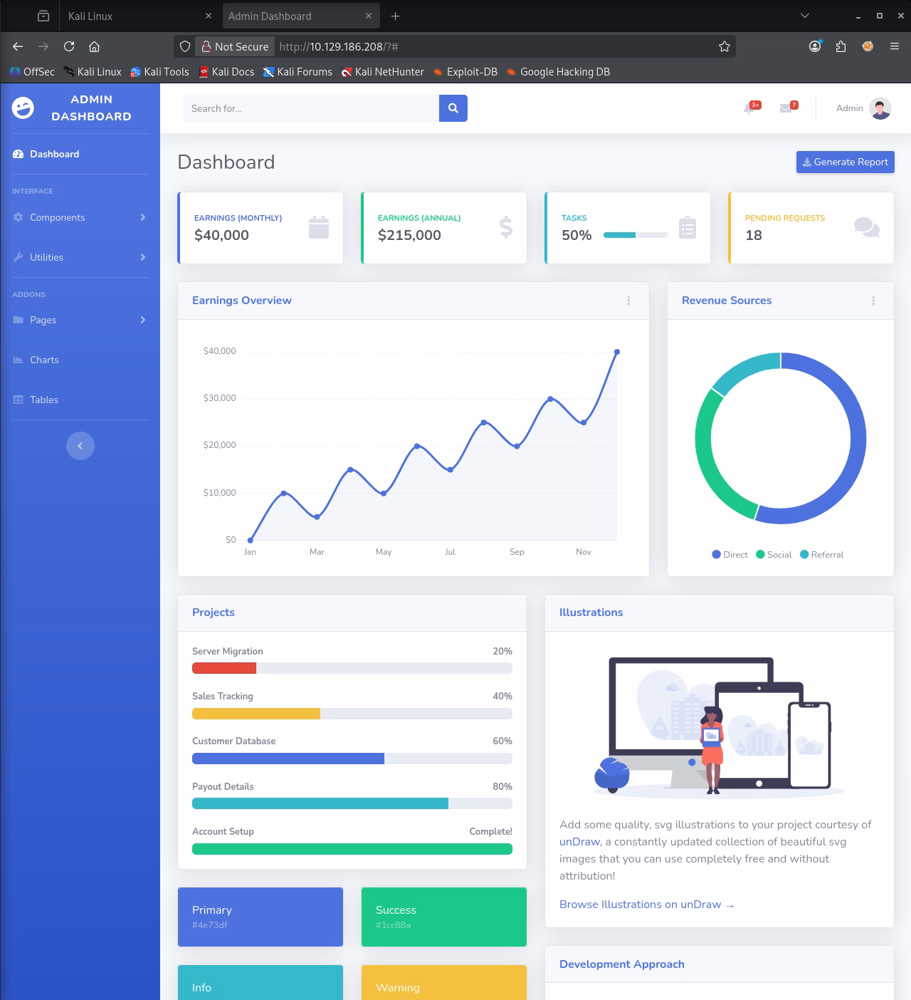
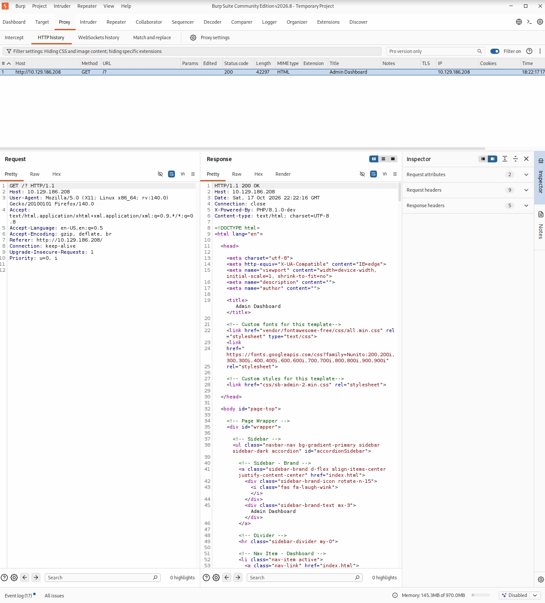
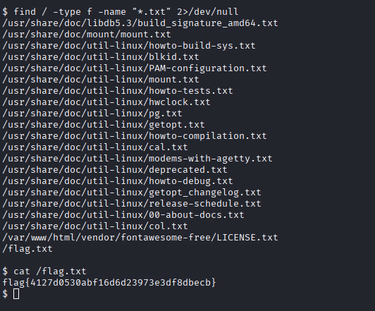

## Exploitation d'une backdoor PHP — Agent T

### Contexte

On nous fournit une adresse IP et on nous dit de bien regarder l'en-tête HTTP :

http

```http
http://10.129.186.208
```

Dans ce cas j'ouvre directement Burp Suite et je lance le navigateur avec l'IP que l'on nous a fournie.



Dans Burp on obtient le résultat suivant :



Dans la réponse HTTP on peut voir la version de PHP exposée via l'en-tête `X-Powered-By` :

http

```http
X-Powered-By: PHP/8.1.0-dev
```

### Analyse de la faille

Après une recherche sur Internet, cette version `8.1.0-dev` n'est pas « vulnérable » au sens d'un bug applicatif classique : il s'agit d'une **backdoor (porte dérobée) introduite dans le code source de PHP**.

En mars 2021, le dépôt git officiel `php-src` a été compromis. Deux commits malveillants, se faisant passer pour des mainteneurs légitimes, y ont inséré une porte dérobée. Le mécanisme est le suivant : si une requête HTTP contient un en-tête `User-Agentt` (avec deux `t`) dont la valeur commence par la chaîne `zerodium`, le code qui suit est exécuté côté serveur via `zend_eval_string()`. Cela donne une **exécution de code à distance (RCE)**.

Exploit public utilisé : [https://www.exploit-db.com/exploits/49933](https://www.exploit-db.com/exploits/49933)

### Exploitation

On récupère l'exploit (script Python) sur notre machine locale, on le lance, puis on renseigne l'URL de la cible. L'exploit automatise l'envoi de l'en-tête piégé et nous ouvre un pseudo-shell interactif.

On vérifie alors sous quel utilisateur on est connecté :

bash

```bash
$ whoami
root
```

On a donc directement un accès **root** sur la machine. Le service web s'exécute avec les privilèges du super-utilisateur, ce qui signifie que la RCE nous donne immédiatement le contrôle total du système — sans même avoir besoin d'une phase d'escalade de privilèges.

### Récupération du flag

On lance une recherche sur l'ensemble du système de fichiers pour localiser les fichiers `.txt` et retrouver le flag :

bash

```bash
find / -name "*.txt" 2>/dev/null
```




On trouve bien notre fichier `flag.txt` et on l'affiche avec `cat` pour valider la room.

## Conclusion

Cette room illustre un cas d'école de **compromission de la chaîne d'approvisionnement (supply chain)** : la faille ne provient pas d'une erreur de programmation de l'application, mais du fait d'avoir déployé une version de développement (`-dev`) de PHP qui s'est révélée piégée à la source.

Deux problèmes se cumulent ici et expliquent la gravité de l'impact :

1. **L'exposition de la version** via l'en-tête `X-Powered-By`, qui livre à l'attaquant l'information exacte dont il a besoin pour choisir son exploit.
2. **Le service web tournant en root**, qui transforme une simple exécution de commande en compromission totale et immédiate du serveur, sans phase d'escalade.

La chaîne complète — reconnaissance de la version → identification de la backdoor publique → RCE → accès root → lecture du flag — se déroule donc en quelques minutes.

## Remédiation

Plusieurs mesures, de la plus urgente à la plus structurelle :

- **Ne jamais déployer de build `-dev` en production.** Les versions de développement ne sont pas destinées à un usage réel. Il faut utiliser exclusivement les versions stables fournies par les dépôts officiels de la distribution ou par php.net, et reconstruire l'environnement à partir d'une source saine (la backdoor est présente dans le binaire lui-même : une simple mise à jour ne suffit pas si l'installation compromise reste en place).

- **Appliquer le principe de moindre privilège.** Le serveur web ne doit jamais tourner en root. Le processus doit être exécuté sous un compte dédié non privilégié (par exemple `www-data`), afin qu'une éventuelle RCE reste cantonnée à ce compte au lieu de donner le contrôle total de la machine.

- **Masquer les informations de version.** Positionner `expose_php = Off` dans le `php.ini` pour supprimer l'en-tête `X-Powered-By`, et plus généralement limiter les bannières qui renseignent un attaquant sur la stack technique.

- **Filtrer en amont.** Un WAF ou un filtrage applicatif des en-têtes HTTP anormaux (ici, un `User-Agentt` contenant du code) permet de détecter et bloquer ce type de tentative.